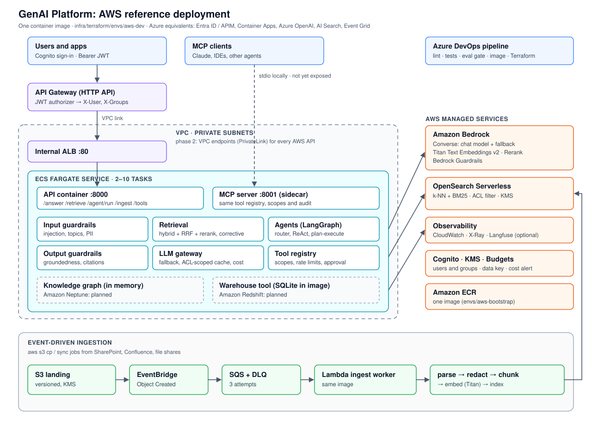

# Enterprise GenAI Platform

A reusable GenAI platform for on-Prem, AWS and Azure: retrieval-augmented generation (RAG), Agentic
workflows, LangGraph and LangChain, Semantic Chunking, Embeddings and Hybrid vector search, a Knowledge Graph, MCP
Server, REST API calls, integrations, Guardrails, and an evaluation gate that blocks bad releases.

# Use Case #

The Large organization hold most of their knowledge in documents, wikis, tickets and databases that people struggle to search. Employees waste time hunting for answers, the same questions keep landing on HR, IT and support teams, and decisions get made on outdated or half-found information. GenAI can fix that, but most companies hit three problems when they try:

Every team builds its own chatbot. HR, IT, Finance and Engineering each build a separate bot with its own search, its own prompts and its own security. Costs multiply, quality varies, and nobody can say which answers are reliable.
Risk blocks production. Pilots look good in a demo, but security and compliance stop them. The worries are wrong answers, confidential data shown to the wrong person, and agents taking actions nobody approved.
Cloud lock-in. The company runs on both AWS and Azure, often after an acquisition, or because different business units chose differently. A solution tied to one cloud’s AI service can’t serve the whole company.

The platform solves this by building the hard parts once: secure search, guardrails, evaluation, tool access and deployment. Each new business use case then becomes a configuration file and a test set instead of a new project. That is the business case: faster delivery, lower cost per use case, and AI the risk and compliance teams can approve.


The sample data in the repo shows the first three working: a leave-policy question answered with its source, “Who owns the Customer-360 Pipeline?” answered from the graph, and revenue by region answered from the warehouse.

# Why each capability matters to the business #
 ##RAG with citations## : answers come from the company’s own documents, with sources people can check. This builds trust and reduces wrong answers.
Access control at search time: someone from Sales never sees HR compensation documents, even by accident. This is usually what gets security sign-off.
Knowledge graph: answers relationship questions (“what breaks if this service fails?”) that plain document search handles poorly.
Agents and MCP: the assistant can do things (query data, open tickets), not just answer. MCP exposes these tools in a standard, governed way, so any approved AI client can use them.
Guardrails and human approval: these block prompt attacks, redact personal data, and stop the system acting without a person saying yes. Risk teams need this before anything goes live.
Evaluation gate: each release is scored against a fixed set of real test questions before it ships. Quality is measured, not judged by feel.
Multi-cloud (AWS and Azure): the same platform runs wherever each business unit’s data lives. This avoids lock-in and lets the company use the best models on each cloud.
The value, and how you’d measure it
Time saved: fewer hours spent searching, and fewer repeat tickets to HR, IT and support. Measure ticket deflection and time to answer.
Faster delivery: the spec targets each new use case live in under 2 weeks, instead of a months-long build.
Lower cost: shared infrastructure, caching and per-request cost tracking keep spend visible and controlled per use case.
Lower risk: access control, guardrails, audit logs and eval gates give compliance something concrete to approve.
Better decisions: managers get data answers in minutes instead of waiting in the analyst queue.

  
A new use case is a **YAML profile plus a golden set**, not a new stack. The same code runs
fully offline (deterministic, free, used in CI), on **AWS** (Bedrock, OpenSearch Serverless,
ECS Fargate, Lambda) and on **Azure** (Azure OpenAI, AI Search, Container Apps).

- **Spec → sprints:** [`docs/IMPLEMENTATION_PLAN.md`](docs/IMPLEMENTATION_PLAN.md)
- **Architecture and security model:** [`docs/architecture.md`](docs/architecture.md)
- **Decisions:** [`docs/adr/`](docs/adr)

## Contents

- [Capabilities](#capabilities)
- [Architecture](#architecture)
- [Quick start (offline)](#quick-start-offline-no-cloud-account)
- [Repository layout](#repository-layout)
- [Deploy to AWS](#deploy-to-aws)
- [Using the deployed platform](#using-the-deployed-platform)
- [Enterprise testing guide and connectors](#enterprise-testing-guide)
- [Run on Azure](#run-on-azure)
- [CI/CD](#cicd)

## Capabilities

| Area | What you get |
| --- | --- |
| Ingestion | Markdown, text, HTML, PDF and DOCX parsers. Recursive, semantic and parent-child chunkers with contextual headers. PII redaction. Idempotent re-ingest. Event-driven on S3 or Blob. |
| Retrieval | Dense + BM25 hybrid search fused with RRF, then reranking, corrective re-query, a GraphRAG route, and cited answers. Document ACLs are enforced inside the store query. |
| Agents | LangGraph router, ReAct and plan-and-execute agents. Step and cost budgets. A human approval gate for write tools. |
| Tools / MCP | One tool registry with scopes, schema validation, rate limits and an audit log, shared by the agents and by the MCP server. |
| Guardrails | Prompt-injection and denied-topic checks, PII, groundedness and citation checks. Bedrock Guardrails or Azure AI Content Safety. |
| LLM gateway | Fallback models, retries, a semantic cache keyed by the caller's ACL scope, and token and cost accounting. |
| Evaluation | Golden-set runner (hit rate, MRR, context recall, faithfulness, refusal, ACL leakage, agent tool accuracy, latency). The CI gate fails on regressions. |

## Architecture



The request path, security model and component diagram are in
[`docs/architecture.md`](docs/architecture.md).

## Quick start (offline, no cloud account)

Requires Python 3.11 or later.

```bash
pip install -e ".[dev]"
make test          # unit + integration tests: ingest, retrieval, guardrails, KG, agents, MCP, API, eval gate
make eval          # golden-set eval; exits 1 if any threshold regresses
make ask Q="How many unused leave days can I carry forward?"
genai agent --scopes kb.read,dw.read "What was the total revenue by region in 2025?"
make run           # API on :8000  (POST /answer, /retrieve, /agent/run, /agent/{id}/approve)
make mcp           # MCP server over stdio (add --http for streamable HTTP on :8001)
```

The offline profile uses a hashed bag-of-words embedder and an extractive stand-in "LLM", so
everything is deterministic and free. Switch to real models by choosing the AWS or Azure profile.

## Repository layout

```
src/genai_platform/
  config.py         use-case profiles (YAML -> typed config, ${ENV} expansion)
  platform.py       composition root: builds every module for a profile
  providers/        LLM gateway (fallback, retry, ACL-scoped semantic cache, cost) + Bedrock/Azure/local
  ingest/           parsers, chunkers (recursive, semantic, parent-child), PII, idempotent pipeline
  vectorstore/      memory, OpenSearch Serverless, Azure AI Search (hybrid + ACL filters)
  retrieval/        hybrid + RRF, rerank, corrective RAG, GraphRAG route, cited answers
  kg/               ontology, extractors (LLM / pattern), entity resolution, graph stores, Cypher guard
  agents/           LangGraph router, ReAct, plan-and-execute; approval gate; budgets
  mcp/              tool registry (scopes, validation, rate limit, audit) + platform tools
  guardrails/       input/output checks + Bedrock Guardrails / Content Safety
  evals/            metrics, golden-set runner, CI gate
services/           api (FastAPI), mcp_server (MCP), ingest_worker (Lambda / Container Apps job)
profiles/ ontology/ evals/golden/ data/   use-case config, ontology, golden sets, sample corpus
infra/terraform/
  envs/aws-bootstrap   ECR repository (applied before the image push)
  envs/aws-dev         the AWS environment; envs/azure-dev for Azure
  modules/aws/         service (ECS), ingest (S3/SQS/Lambda), opensearch_vector, bedrock,
                       api_gateway (Cognito + HTTP API), endpoints (VPC endpoints, phase 2)
pipelines/          Azure DevOps YAML + templates
.github/workflows/  GitHub Actions CI (lint, tests, eval gate, terraform validate)
```

## Deploy to AWS

### Two phases

You deploy in two phases, controlled by one pipeline variable: `awsPrivateNetworking` in
[`pipelines/azure-pipelines.yml`](pipelines/azure-pipelines.yml). It is passed to Terraform as
`private_networking`.

| | Phase 1: public endpoints (`false`, default) | Phase 2: private endpoints (`true`) |
| --- | --- | --- |
| AWS service access | Public endpoints through NAT (or public subnets + `assign_public_ip`) | VPC endpoints (`modules/aws/endpoints`), no NAT needed |
| OpenSearch Serverless | Public endpoint, IAM data-access policy | Its VPC endpoint only |
| Ingest Lambda | Outside the VPC | In the private subnets |
| Cloud eval | On the hosted `ubuntu-latest` agent | One-off ECS task in the VPC; its exit code gates the stage |
| Client access | API Gateway + Cognito → VPC link → internal ALB | Same |

### What Terraform creates

- **`envs/aws-bootstrap`:** the ECR repository (immutable tags, scan on push, keeps the last 50
  images). It exists so the image can be pushed before the environment is applied.
- **`envs/aws-dev`:**
  - **ECS Fargate:** 2–10 autoscaled tasks, each running the API on port 8000 and an MCP
    sidecar on port 8001, behind an internal ALB.
  - **API Gateway** HTTP API with a Cognito JWT authorizer, reaching the ALB over a VPC link.
  - **Ingestion:** an S3 landing bucket feeding EventBridge → SQS (with a DLQ) → a Lambda ingest
    worker that runs the same image.
  - **OpenSearch Serverless** vector collection.
  - **Bedrock Guardrail:** content filters, prompt attacks, PII, a denied topic, and contextual
    grounding.
  - **Shared:** a KMS key, the security group, and a $2,000/month budget alert.
  - **Phase 2 only:** VPC endpoints for Bedrock runtime, Bedrock agent runtime (Rerank), ECR,
    S3, CloudWatch Logs, STS, SQS, Comprehend and Textract.

The VPC and subnets are **not** created. They come from your landing zone.

### Prerequisites

- **Network:** an existing VPC with two or more private subnets. In phase 1 they need outbound
  internet access through a NAT gateway. If you only have public subnets, set
  `assign_public_ip = true`.
- **Bedrock model access** in your region for:
  - the chat model and the fallback model (a model ID or inference-profile ARN);
  - `amazon.titan-embed-text-v2:0`.

  The AWS profile uses `reranker: bedrock`. Check that Bedrock Rerank is offered in your region,
  or change the reranker.
- **Terraform state:** an S3 bucket and a DynamoDB lock table. Terraform 1.6 or later.
- **Azure DevOps:**
  - A variable group named `genai-platform-common` containing:

    | Variable | Value |
    | --- | --- |
    | `awsServiceConnection` | Name of the AWS service connection (OIDC) |
    | `awsRegion` | e.g. `ap-south-1` |
    | `ecrRegistry` | `<account-id>.dkr.ecr.<region>.amazonaws.com` |
    | `tfStateBucket`, `tfLockTable` | Terraform state bucket and lock table |

  - `aws-dev.tfvars`, created from
    [`dev.tfvars.example`](infra/terraform/envs/aws-dev/dev.tfvars.example) and made available
    at `$(Agent.TempDirectory)`, for example as a secure file.

### Phase 1: public endpoints

1. **Fill in `aws-dev.tfvars`.** Put the IAM role behind `awsServiceConnection` in
   `eval_principal_arns`. That role runs the cloud eval and must be allowed to read and write
   the OpenSearch index.
2. **Push to `main`.** The pipeline then:
   1. runs lint, the tests and the offline eval gate;
   2. in the Build stage, applies `envs/aws-bootstrap` (ECR) and pushes the image tagged with
      the commit SHA;
   3. in Deploy_AWS_Dev, applies `envs/aws-dev`, writes the Terraform outputs to a file, and
      runs the golden-set eval against Bedrock and OpenSearch from the hosted agent. A failing
      eval blocks promotion.
3. **Load your documents.** The services start with `GENAI_INGEST_ON_START=false`. The cloud
   eval has already indexed the sample corpus.

   ```bash
   aws s3 cp ./my-docs/ s3://$(terraform output -raw landing_bucket)/ --recursive
   ```

   Each object flows S3 → EventBridge → SQS → the Lambda worker. Failures land in the DLQ after
   three attempts.

### Phase 2: private endpoints

1. Add `private_route_table_ids` (the route tables of `private_subnet_ids`) to `aws-dev.tfvars`.
2. Set `awsPrivateNetworking: "true"` in the pipeline and push. Terraform then:
   - creates the VPC endpoints;
   - switches OpenSearch to VPC-only access;
   - moves the Lambda into the VPC.

   The cloud eval now runs as an ECS task. Its summary is in CloudWatch Logs (`/genai/genai-dev`,
   stream prefix `api`).
3. Once phase 2 is healthy, remove the NAT route and remove the pipeline role from
   `eval_principal_arns`.

### Manual deploy (without the pipeline)

```bash
# 1. ECR repository
cd infra/terraform/envs/aws-bootstrap
terraform init -backend-config="bucket=<state-bucket>" -backend-config="key=genai/aws-bootstrap-dev.tfstate" \
  -backend-config="region=ap-south-1" -backend-config="dynamodb_table=<lock-table>"
terraform apply -var region=ap-south-1 -var env=dev
REPO=$(terraform output -raw ecr_repository_url)

# 2. Image (tags are immutable: use a new tag for every build)
cd ../../../..
aws ecr get-login-password | docker login --username AWS --password-stdin ${REPO%/*}
docker build -t $REPO:v1 . && docker push $REPO:v1

# 3. Environment
cd infra/terraform/envs/aws-dev
cp dev.tfvars.example dev.tfvars      # then edit
terraform init -backend-config="bucket=<state-bucket>" -backend-config="key=genai/aws-dev.tfstate" \
  -backend-config="region=ap-south-1" -backend-config="dynamodb_table=<lock-table>"
terraform apply -var-file=dev.tfvars -var image_tag=v1
terraform output                       # api_url, user_pool_id, user_pool_client_id, landing_bucket, ...
```

### Known limits

- **Knowledge graph.** It is in memory, one per task, until Amazon Neptune is provisioned
  (Neptune is not yet in Terraform). Documents ingested by the Lambda reach OpenSearch but not
  the API's graph. To switch, set `KG_STORE=neptune` and `NEPTUNE_BOLT_URI` in `app_env`.
  Neptune with IAM auth also needs SigV4 signing in `Neo4jGraph`.
- **MCP server.** It runs as a sidecar but is not exposed through the gateway, because it uses
  one fixed caller identity (`MCP_SCOPES` / `MCP_GROUPS`) instead of per-request auth.
- **Agent approvals.** Pending approvals are held in the memory of the task that started the
  run. With two or more tasks, `/agent/{id}/approve` can land on another task and return 404.
  Move them to a shared store (DynamoDB or ElastiCache) before production.
- **Warehouse tool.** It reads a SQLite file baked into the image, and `create_ticket` writes to
  the container's disk. Both are demo backends; see [Connectors](#connector-catalogue).
- **Untested against AWS.** The cloud adapters have not yet been run against a live account, so
  expect fixes on the first deploy.

## Using the deployed platform

### Identity, groups and scopes

Users are Cognito users. The gateway validates the JWT and sets `X-User` (the `sub` claim) and
`X-Groups` (the `cognito:groups` claim). It also strips any `X-Scopes` header the client sends,
so callers cannot fake their identity. Groups do two jobs:

| Group | Meaning |
| --- | --- |
| `hr`, `engineering`, … | **Document ACLs.** They match the `acl:` list in a document's front matter. `public` documents are visible to everyone. |
| `scope:kb.read`, `scope:graph.read`, `scope:dw.read`, `scope:tickets.write`, `scope:kb.admin` | **Tool scopes.** Every caller has `kb.read`. |

Put every user in at least one group. Add more groups through the `cognito_groups` variable of
`modules/aws/api_gateway`. To sign in through your corporate identity provider (Entra ID, Okta,
Ping), add a SAML or OIDC identity provider to the user pool and map its group claims to
Cognito groups.

### Calling the API

```bash
cd infra/terraform/envs/aws-dev
POOL=$(terraform output -raw user_pool_id); CLIENT=$(terraform output -raw user_pool_client_id)
API=$(terraform output -raw api_url)

aws cognito-idp admin-create-user --user-pool-id $POOL --username asha --message-action SUPPRESS
aws cognito-idp admin-set-user-password --user-pool-id $POOL --username asha --password '<Long-P@ssw0rd>' --permanent
aws cognito-idp admin-add-user-to-group --user-pool-id $POOL --username asha --group-name hr
aws cognito-idp admin-add-user-to-group --user-pool-id $POOL --username asha --group-name scope:dw.read

TOKEN=$(aws cognito-idp initiate-auth --client-id $CLIENT --auth-flow USER_PASSWORD_AUTH \
  --auth-parameters USERNAME=asha,PASSWORD='<Long-P@ssw0rd>' --query AuthenticationResult.AccessToken --output text)

curl $API/healthz
curl -X POST $API/answer -H "Authorization: Bearer $TOKEN" -H "Content-Type: application/json" \
  -d '{"question": "How many unused leave days can I carry forward?"}'
curl -X POST $API/agent/run -H "Authorization: Bearer $TOKEN" -H "Content-Type: application/json" \
  -d '{"question": "What was the total revenue by region in 2025?"}'
```

| Endpoint | Purpose |
| --- | --- |
| `GET /healthz` | Status, profile name, number of indexed chunks (no auth) |
| `POST /answer` `{"question", "filters"?}` | Grounded answer with citations, guardrail verdict, usage and trace id |
| `POST /retrieve` `{"query", "top_n"?}` | Raw ranked chunks, ACL-filtered |
| `POST /agent/run` `{"question", "pattern"?}` | Agent run (`router`, `react`, `plan_execute`); may pause with `awaiting_approval` |
| `POST /agent/{thread_id}/approve` `{"approved"}` | Resume or reject a paused write action |
| `POST /ingest` `{"paths"?}` | Re-ingest files baked into the image; needs `scope:kb.admin` |
| `GET /tools` | Tool schemas visible to the caller |

### From an MCP client

Run the MCP server locally with the cloud profile and register it with your client. For
example, with Claude Code:

```bash
claude mcp add genai-platform --env GENAI_PROFILE=profiles/knowledge-assistant.aws.yaml \
  --env MCP_SCOPES=kb.read,graph.read,dw.read --env MCP_GROUPS=engineering \
  -- python -m services.mcp_server.server
```

The MCP server exposes `search_knowledge`, `answer_question`, `graph_neighbours`,
`warehouse_schema` and `query_warehouse` (each only when the caller has its scope), plus the
`kb://stats` resource.

## Enterprise testing guide

This section is for teams evaluating the platform for enterprise use: what to connect, what to
test, and what has to be true before go-live.

### 1. Set up a test tenant

1. Deploy phase 1 to a **non-production AWS account** with its own Cognito pool. Keep phase 2
   (private endpoints) for the security test round.
2. Create one Cognito user per persona, e.g. `employee`, `hr-partner`, `engineer`,
   `analyst` (`scope:dw.read`), `admin` (`scope:kb.admin`). ACL testing needs at least two
   users who should see *different* documents.
3. Copy `profiles/knowledge-assistant.aws.yaml` to `profiles/<your-use-case>.aws.yaml`. Point
   `corpus_paths` and `evals.golden_set` at your data.
4. Load a **representative, de-identified** sample of your corpus (a few hundred documents is
   enough to start).

> [!IMPORTANT]
> **ACLs today come only from Markdown front matter** (`acl: [hr]`). HTML, PDF and DOCX files are
> indexed as `public`, so every user can see them. Until an ACL source is wired in for those
> formats (S3 object tags, a sidecar `.acl.json`, or the source system's permissions), use only
> non-sensitive files of those types, or convert them to Markdown with front matter first.

### 2. Connector catalogue

**Available** = built and covered by tests or Terraform. **Partial** = code exists but is not
wired in. **Planned** = not built; the pattern to add it is given.

| Category | Connector | Status | How to use or add it |
| --- | --- | --- | --- |
| Document sources | Local folders (`corpus_paths`) | Available | List paths in the profile; `genai ingest --profile …` or `POST /ingest` |
| | Amazon S3 landing bucket | Available | Upload to `landing_bucket`; the event-driven Lambda indexes each object |
| | Azure Blob Storage | Available | Event Grid → `azure_handler` (Container Apps job) |
| | SharePoint / OneDrive, Confluence, Google Drive, file shares, Box | Planned | Run a sync job (a scheduled task, or a managed transfer service that supports the source) that writes files **plus their ACLs** into the landing bucket |
| File formats | Markdown, text, HTML, PDF (text layer), DOCX | Available | Install the `parsing` extra (included in the image) |
| | Scanned PDFs / forms (Amazon Textract, Azure Document Intelligence) | Partial | `TextractParser` / `DocumentIntelligenceParser` exist; call them from the ingest worker for image-only PDFs |
| Models | Amazon Bedrock (Converse, Titan v2 embeddings, Rerank) | Available | `models.provider: aws`; set `BEDROCK_CHAT_MODEL` / `BEDROCK_FALLBACK_MODEL` |
| | Azure OpenAI | Available | `models.provider: azure` |
| | Local deterministic models | Available | `models.provider: local` (CI and offline tests) |
| Vector stores | OpenSearch Serverless, Azure AI Search, in-memory | Available | `vectorstore.kind: opensearch \| azure_search \| memory` |
| Knowledge graph | In-memory | Available | `kg.store: memory` |
| | Neo4j (Bolt) | Available | `kg.store: neo4j`, `kg.uri` |
| | Amazon Neptune (openCypher over Bolt) | Partial | Needs a Neptune cluster (not in Terraform) and SigV4 auth in `Neo4jGraph` |
| | Azure Cosmos DB (Gremlin) | Planned | Accepted by the config but currently falls back to in-memory |
| Guardrails | Built-in checks | Available | Always on |
| | Bedrock Guardrails, Azure AI Content Safety | Available | `guardrails.provider: bedrock \| azure_content_safety` (Terraform creates the Bedrock guardrail) |
| | PII: regex redaction | Available | `chunking.redact_pii: true` |
| | PII: Amazon Comprehend / Azure AI Language | Partial | `CloudPIIRedactor` exists; swap it in for `PIIRedactor` in `platform.py` |
| Agent / MCP tools | `search_knowledge`, `answer_question`, `graph_neighbours` | Available | Scopes `kb.read`, `graph.read` |
| | `warehouse_schema`, `query_warehouse` (read-only SQL guard) | Available (SQLite demo) | Swap the backend for the Redshift Data API or Synapse with a read-only role |
| | `create_ticket` (write, needs approval) | Available (demo, writes JSONL) | Replace with your ITSM (ServiceNow, Jira) API; keep `kind="write"` so approval stays on |
| | Email, chat (Teams, Slack), CRM, HR systems | Planned | Register a `ToolSpec` (see below) |
| Identity | Amazon Cognito (users, groups) | Available | `modules/aws/api_gateway` |
| | Corporate IdP (Entra ID, Okta, Ping) via SAML/OIDC | Planned | Federate into the Cognito user pool and map group claims |
| Observability | JSON logs → CloudWatch, Container Insights, X-Ray (Lambda) | Available | On by default |
| | Langfuse traces | Available | Set `LANGFUSE_PUBLIC_KEY` / `LANGFUSE_SECRET_KEY` |
| Evaluation | Golden-set runner + CI gate | Available | `genai eval --profile …` |
| | RAGAS (LLM-judged) | Partial | `ragas_scores()` exists; not yet a CLI flag. Install the `evals` extra |
| MCP clients | Claude Code, Claude Desktop, IDEs (stdio) | Available | See [From an MCP client](#from-an-mcp-client) |
| | Remote MCP over streamable HTTP | Partial | The sidecar runs; it needs per-request OAuth before it is exposed |

#### Adding a tool connector

Every tool goes through the registry, so scopes, validation, rate limits, approval and audit
apply automatically to agents and to MCP clients:

```python
# src/genai_platform/mcp/tools.py, inside register_platform_tools()
def lookup_incident(number: str, _principal: Principal | None = None):
    return servicenow_client.get_incident(number)          # your client; least-privilege credentials

registry.register(ToolSpec("lookup_incident", "Fetch a ServiceNow incident by number.",
                           lookup_incident, {"number": {"type": "string"}},
                           scopes=["itsm.read"], rate_limit_per_min=30))
```

Add a matching `scope:itsm.read` Cognito group, plus `agent`-type golden cases that expect the
new tool.

#### Adding a document source

Write files to the S3 landing bucket. Use one prefix per source (e.g. `sharepoint/hr/…`) so
deletes and re-syncs are scoped, and carry permissions with each file. For Markdown, put them in
the front matter:

```markdown
---
title: Leave policy 2026
acl: [hr, managers]
source_system: sharepoint
---
```

### 3. Test plan

| Layer | What to test | How | Pass criteria |
| --- | --- | --- | --- |
| Unit / offline | Parsers, chunkers, retrieval, guardrails, agents, MCP, API | `make test`, `make eval` (CI on every PR) | All green |
| Answer quality | Golden set on **your** corpus: 50–200 questions with expected sources, written by subject-matter experts | `genai eval --profile profiles/<use-case>.aws.yaml --report reports/eval.json` | Profile thresholds, e.g. hit_rate@5 ≥ 0.80, faithfulness ≥ 0.85, latency p95 ≤ 2.5 s |
| Access control | Each persona asks for content it must **not** see; `acl`-type golden cases with `forbidden_sources` / `forbidden_contains` | Eval runner + manual checks through the API with each persona's token | `acl_leakage_free = 1.0`, no exceptions |
| Identity spoofing | Send forged `X-User` / `X-Groups` / `X-Scopes` headers through API Gateway | `curl` with a valid token plus forged headers | Forged values ignored (the gateway overwrites or strips them) |
| Prompt injection and safety | Jailbreaks, prompt-leak attempts, denied topics, injected instructions inside documents | `refusal` golden cases + a red-team list | `refusal_accuracy = 1.0`; Bedrock Guardrail blocks recorded |
| PII | Seed documents with synthetic emails, phones and card numbers | Ingest, then search for them | Redacted in chunks; card numbers blocked by the guardrail |
| Tools and agents | Scope enforcement, read-only SQL guard, approval for writes, budget limits | `agent` golden cases; try `DROP`/`UPDATE` through `query_warehouse` | Unauthorised tools invisible; writes pause for approval; SQL guard rejects writes |
| Ingestion | Bulk upload, re-upload (idempotency), corrupt files, oversized files | Upload to the landing bucket; watch SQS, Lambda and the DLQ | No duplicate chunks; failures land in the DLQ, not lost |
| Performance | Concurrent users on `/answer` and `/agent/run` | A load tool (k6, Locust, JMeter) against `api_url` with real tokens | p95 within target; ECS autoscaling 2→10 tasks; no API Gateway 429s at expected load |
| Resilience | Primary model throttled or unavailable; one task killed | Point `BEDROCK_CHAT_MODEL` at a model without access; stop a task | Fallback model answers; the service self-heals |
| Network (phase 2) | No public path to data | Flip `awsPrivateNetworking`; confirm OpenSearch rejects calls from outside the VPC | Cloud eval passes from inside the VPC only |
| Cost | Spend per 1,000 answers | `usage` on each `/answer` response; AWS Budgets alert | Within the business case |
| User acceptance | Real users, real questions | Pilot group; collect thumbs up/down and failure cases into the golden set | Agreed satisfaction target |

### 4. Go-live checklist

- [ ] Phase 2 (private endpoints) enabled and the NAT route removed
- [ ] ACLs present on **every** indexed document, including non-Markdown sources
- [ ] Corporate IdP federated into Cognito; local test users removed
- [ ] Agent approval state moved to a shared store; Neptune or Neo4j for the graph
- [ ] Demo backends replaced (warehouse → Redshift, tickets → ITSM)
- [ ] Golden set signed off by the business owner; cloud eval gate green
- [ ] Alarms on API 5xx, Lambda errors and DLQ depth; budget alert recipients confirmed
- [ ] Data retention and deletion path tested (delete in source → removed from the index)

## Run on Azure

| | AWS | Azure |
| --- | --- | --- |
| Profile | `profiles/knowledge-assistant.aws.yaml` | `profiles/knowledge-assistant.azure.yaml` |
| Infra | `infra/terraform/envs/aws-dev` | `infra/terraform/envs/azure-dev` |
| Models | Amazon Bedrock (Converse, Titan v2) | Azure OpenAI |
| Vector + keyword | OpenSearch Serverless | Azure AI Search |
| Graph | In memory (Amazon Neptune planned) | Neo4j |
| Guardrails | Bedrock Guardrails | Azure AI Content Safety |
| Compute | ECS Fargate + Lambda ingest | Container Apps + queue-triggered job |
| Front door | API Gateway + Cognito | Azure API Management + Entra ID (not yet in Terraform) |
| Install extra | `pip install -e ".[aws]"` | `pip install -e ".[azure]"` |

## CI/CD

- **Azure DevOps** ([`pipelines/azure-pipelines.yml`](pipelines/azure-pipelines.yml)): lint,
  tests, the offline eval gate, the image build (ECR and ACR), Terraform for both clouds, then
  a cloud eval that blocks promotion.
- **GitHub Actions** ([`.github/workflows/ci.yml`](.github/workflows/ci.yml)): lint, tests, the
  offline eval gate and `terraform validate`/`fmt` on every push and pull request. No cloud
  credentials needed.
