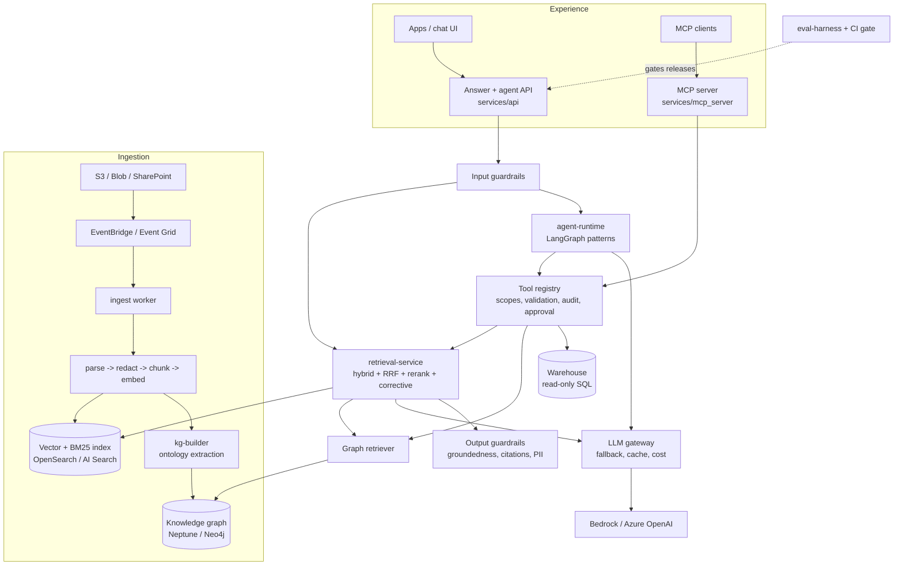

# Architecture

## Request path (RAG)

1. **Input guardrails:** prompt-injection patterns, denied topics, length, PII redaction; then Bedrock Guardrails or Content Safety when configured.
2. **Optional query rewrite** through the LLM gateway.
3. **Retrieval:** dense + BM25 (+ graph-linked chunks), each ACL-filtered at the store, fused with RRF, then reranked to top N.
4. **Corrective step:** if the best score is under `min_relevance`, widen with keyword search once.
5. **Generation:** numbered sources and a citation-required system prompt. The semantic cache is keyed by the question *and* the caller's ACL scope.
6. **Output guardrails:** groundedness check (abstain if low), citation validity, PII redaction, managed-service check with grounding source.
7. **Response:** answer, citations (chunk id, source, section), trace id, usage (tokens, cost, latency, prompt version).

## Security model

- **Document-level ACLs:** captured at ingest, stored on every chunk, enforced as a filter inside each store query (never post-filtered in the app).
- **Tools:** least privilege by scope; write tools pause for human approval; the SQL and Cypher guards are backed by read-only database roles in cloud.
- **Identity:** Entra ID / IAM roles end to end; no API keys in cloud profiles; private endpoints for models, search and storage.
- **Audit:** every tool call (allowed or denied) is logged with subject, arguments and outcome.
